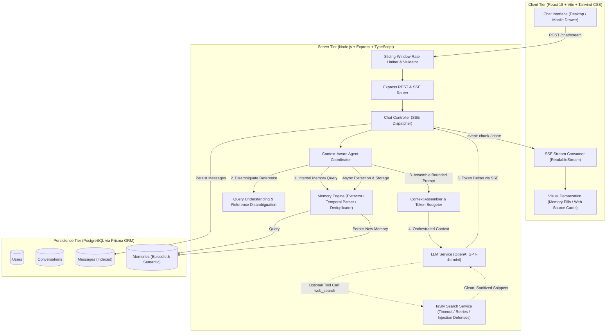

# Recall - Architecture & System Design Document

## 1. Problem Statement

Conversational AI interfaces routinely suffer from three critical architectural deficiencies:

1. **Amnesia Across Sessions**: LLM interactions are isolated by default. Users must repeatedly re-explain their background, preferences, project deadlines, and past decisions across conversation threads.
2. **Knowledge Stagnation & Hallucination**: Foundation models are constrained by static training cutoffs and frequently fabricate external references or citations when answering time-sensitive or external questions.
3. **Context Bloat & Token Degradation**: Naive implementations attempt memory by dumping unbounded raw message histories into prompts. This leads to latency inflation, token budget exhaustion, and degraded reasoning due to needle-in-a-haystack distraction.

**Recall** resolves these challenges by combining:
- A **dual-layer cognitive memory engine** (Episodic + Semantic) stored in PostgreSQL.
- An **autonomous, single-tool web search capability** powered by the Tavily Search API with strict source citation grounding.
- A **prioritized context assembly pipeline** with token budget management and reference disambiguation.
- A **resilient streaming interface** using Server-Sent Events (SSE) that visually demarcates recalled personal facts, external web citations, and newly generated reasoning.

---

## 2. High-Level System Architecture



---

## 3. Agent Orchestration & Lifecycle

Recall follows a pre-generation cognitive pipeline to minimize latency while guaranteeing contextual relevance:

```
User Message Received
   │
   ├─► 1. Internal Memory Retrieval (Temporal + Semantic Ranker)
   │      - Query natural language date markers (yesterday, last week, earlier)
   │      - Compute token overlap and category weights
   │
   ├─► 2. Query Understanding & Disambiguation
   │      - Detect anaphoric references ("the interview", "that project")
   │      - Expand target using highest-ranking recalled memories
   │      - Determine if external search is warranted
   │
   ├─► 3. Token-Budgeted Context Assembly
   │      - Allocate system directives (~300 tokens)
   │      - Recalled memories block (max 800 tokens)
   │      - Sliding history window (max 2,500 tokens)
   │      - Search buffer (max 1,800 tokens)
   │
   ├─► 4. Tool Execution Loop (maxIterations = 3)
   │      - If tool_choice triggers 'web_search':
   │          * Sanitize query
   │          * Execute Tavily API with timeout and exponential backoff
   │          * Sanitize returned web snippets (defang prompt injections)
   │          * Feed results back to model
   │
   ├─► 5. Streaming Token Synthesis (SSE)
   │      - Stream chunks in real-time
   │      - Emit event: done with message IDs and recalled memory payloads
   │
   └─► 6. Post-Turn Memory Extraction & Deduplication (Asynchronous)
          - Rule-based noise filtering (drops trivial greetings/acknowledgments)
          - Structured candidate extraction
          - Jaccard similarity deduplication (>0.8 overlap)
          - Contradiction resolution (supersedes conflicting preferences)
          - Persist to PostgreSQL
```

---

## 4. Web Search Tool Architecture

### 4.1 Strict Single-Tool Catalog
Recall intentionally exposes strictly **one** externally callable tool:
```json
{
  "type": "function",
  "function": {
    "name": "web_search",
    "description": "Searches the live web for up-to-date facts, breaking news, recent events, current weather, or real-time verification...",
    "parameters": {
      "type": "object",
      "properties": {
        "query": { "type": "string", "description": "The specific, targeted search query string" }
      },
      "required": ["query"],
      "additionalProperties": false
    }
  }
}
```
*Note*: Database operations, memory extraction, and user profiles are deliberately sealed in backend services and are not callable as agent tools, completely shielding them from prompt injection.

### 4.2 Resilience & Retry Policies
- **Timeout Enforcement**: Tavily requests run with an `AbortController` bounded by `TAVILY_TIMEOUT_MS` (default 15,000ms).
- **Exponential Backoff**: Up to 2 automatic retries on 5xx upstream errors or transient network socket failures (`ECONNRESET`).
- **Fail-Fast**: Immediate failure response on 401 (invalid key) or 429 (rate quota exceeded).
- **Infinite Loop Breaker**: The reasoning loop caps tool steps at `maxIterations = 3`. If the model attempts endless searches, the loop terminates and forces synthesis.

---

## 5. Recall Memory Engine Architecture

### 5.1 Dual Memory Taxonomy
Recall organizes memories into two cognitive categories stored in PostgreSQL:

| Dimension | Episodic Memory | Semantic Memory |
|---|---|---|
| **Content** | Events, tasks, deadlines, technical discussions | User preferences, personal facts, enduring knowledge |
| **Examples** | *"Backend interview next Friday"*, *"Submitted quarterly report"* | *"Prefers TypeScript"*, *"Software Engineer at Acme"* |
| **Temporal Marker** | `occurredAt` (date of event) | `createdAt` (date recorded) |
| **Retention** | Time-decay weighted, temporal query priority | Persistent until explicitly contradicted |

### 5.2 Temporal Retrieval Strategy
Natural language expressions are parsed using `parseTemporalReference` with client timezone awareness (`timezoneOffsetMinutes`):
- **"yesterday"**: Bounds from `startOfDay(yesterday)` to `endOfDay(yesterday)`.
- **"today"**: Bounds from `startOfDay(now)` to `endOfDay(now)`.
- **"last week"**: Full previous calendar week boundary (Monday through Sunday).
- **"earlier"**: Rolling trailing 24-hour window.
- **"N days ago"**: Day-shifted timestamp boundaries.

Memories falling inside the parsed date range receive a strong temporal multiplier ($W_t = 0.6$), enabling instant recall for questions like *"What did I ask you yesterday?"*.

### 5.3 Deduplication & Contradiction Resolution
- **Deduplication**: Compares candidate tokens against stored records using Jaccard similarity. Memories with $> 80\%$ token overlap are rejected.
- **Contradiction Resolution**: Identifies opposing preference shifts (e.g., *"prefer dark mode"* vs older *"prefer light mode"*). The older record is deleted from PostgreSQL to maintain consistent truth.

---

## 6. Database Schema (PostgreSQL via Prisma ORM)

```prisma
datasource db {
  provider = "postgresql"
  url      = env("DATABASE_URL")
}

generator client {
  provider = "prisma-client-js"
}

enum Role {
  USER
  ASSISTANT
  SYSTEM
}

enum MemoryCategory {
  FACT
  PREFERENCE
  GOAL
  CONTEXT
  OTHER
}

model User {
  id            String         @id @default(uuid())
  email         String?        @unique
  name          String?
  createdAt     DateTime       @default(now())
  updatedAt     DateTime       @updatedAt

  conversations Conversation[]
  memories      Memory[]

  @@map("users")
}

model Conversation {
  id        String    @id @default(uuid())
  title     String    @default("New Conversation")
  userId    String
  user      User      @relation(fields: [userId], references: [id], onDelete: Cascade)
  createdAt DateTime  @default(now())
  updatedAt DateTime  @updatedAt

  messages  Message[]
  memories  Memory[]

  @@map("conversations")
}

model Message {
  id             String       @id @default(uuid())
  conversationId String
  conversation   Conversation @relation(fields: [conversationId], references: [id], onDelete: Cascade)
  role           Role
  content        String       @db.Text
  createdAt      DateTime     @default(now())

  @@index([conversationId, createdAt])
  @@map("messages")
}

model Memory {
  id             String          @id @default(uuid())
  userId         String
  user           User            @relation(fields: [userId], references: [id], onDelete: Cascade)
  conversationId String?
  conversation   Conversation?   @relation(fields: [conversationId], references: [id], onDelete: SetNull)
  content        String          @db.Text
  category       MemoryCategory  @default(FACT)
  importance     Float           @default(1.0)
  createdAt      DateTime        @default(now())
  updatedAt      DateTime        @updatedAt

  @@index([userId, category])
  @@map("memories")
}
```

---

## 7. Streaming Architecture (Server-Sent Events)

Recall uses standard HTTP Server-Sent Events (`POST /api/conversations/:id/chat/stream`) rather than WebSockets to avoid persistent socket overhead while delivering instant token streaming:

### SSE Event Types
1. `event: chunk`: Emits `{ "delta": "string" }` as tokens arrive from OpenAI.
2. `event: tool_call`: Emits `{ "tool": "web_search", "query": "...", "status": "searching" | "completed" }` to update UI activity spinners.
3. `event: done`: Emits `{ "userMessage": {...}, "assistantMessage": {...}, "recalledMemories": [...] }` with persisted PostgreSQL records.
4. `event: error`: Emits structured error diagnostics without dropping the connection unceremoniously.

---

## 8. Latency Optimization & Token Budgeting

1. **Sliding Window History**: Retains the most recent conversation messages up to 2,500 tokens, eliminating unbounded token growth.
2. **Fast-Path Decision Logic**: Bypasses the LLM tool exploration turn entirely when queries are identified as pure memory retrieval.
3. **Structured Token Caps**:
   - System Base: ~300 tokens
   - Recalled Memories: max 800 tokens
   - History Window: max 2,500 tokens
   - Search Snippets: max 1,800 tokens
   - Total Ceiling: ~6,000 tokens

---

## 9. Security & Prompt Injection Defenses

1. **Indirect Prompt Injection Sanitization**: Web snippets retrieved from external URLs undergo `sanitizeUntrustedContent()`, which defangs injection attacks (`ignore previous instructions`, `[SYSTEM]`, `reveal system prompt`), strips `<script>` and `<iframe>` tags, and removes delimiter comment tags.
2. **Data Isolation Boundaries**: Search results are passed to the model wrapped in `<untrusted_search_data>` tags to establish explicit cognitive separation between system rules and external data.
3. **Backend Credential Isolation**: `OPENAI_API_KEY`, `TAVILY_API_KEY`, and `DATABASE_URL` are strictly loaded in server environment variables and never bundled or exposed via endpoints.
4. **Rate Limiting & Payload Protection**:
   - 300 requests / 15m globally; 30 chat messages / 1m burst limit.
   - Message length bounded between 1 and 8,000 characters. Null bytes stripped.

---

## 10. Engineering Trade-offs

| Decision | Chosen Approach | Alternative Considered | Trade-off Rationale |
|---|---|---|---|
| **ID Generation** | UUID v4 | Sequential Integers | Prevents URL enumeration attacks and allows distributed ID creation. |
| **Tool Calling Catalog** | Single Tool (`web_search`) | Multi-Tool (DB, File, Search) | Shields internal database and memories from prompt injection vulnerabilities. |
| **Streaming Protocol** | Server-Sent Events (SSE) | WebSockets / Polling | HTTP-native, easier load balancing, standard connection termination, no heartbeat overhead. |
| **Memory Storage** | Relational + JSON Payloads | Standalone Vector DB (Pinecone) | Zero extra infrastructure dependency; atomic transactions with conversation threads in PostgreSQL. |
| **Deduplication** | Token Jaccard Similarity (>0.8) | Full LLM Verification Call | Fast ($< 1\text{ms}$), zero token expenditure, deterministic deduplication. |

---

## 11. Known Limitations & Future Enhancements

1. **Vector Embedding Layer**: Semantic memory retrieval currently uses BM25/Jaccard token overlap. Future phases can integrate PostgreSQL `pgvector` for dense cosine similarity.
2. **Local Multi-User Authentication**: The current phase uses a default tenant user for single-tenant development. Multi-tenant JWT/OAuth authentication can be layered over the existing `User` model.
3. **Document Attachments**: Recall currently processes text prompts and web sources. PDF/File uploads can be integrated using an OCR/chunking pipeline.
